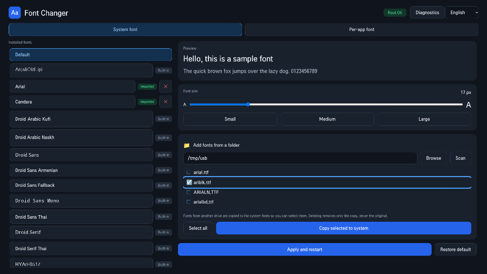

# Font Changer (LG webOS TV)

Font Changer is a font customization utility for rooted LG webOS TVs. Its interface provides font browsing, preview, font-size adjustment, font importing, system-font selection and per-app font controls.

## Requirements
- LG webOS TV 4.0 or later (claimed minimum; compatibility beyond the tested device is not established)
- Root access

## Tested device
- **Model:** LG 65QNED80SRA
- **webOS:** 10.3.2

This is the device/version reported as tested by the developer. It does not establish compatibility with every webOS 4.0+ device.

## Release
- Version: `1.0.0`
- Package ID: `com.ipk.fontchanger`
- IPK filename: `com_ipk_fontchanger_1_0_0_all.ipk`
- SHA-256: `0dd73c609a376da7905f559181eeecd7c0a06d1ee753c9008f1cb9740e9126d9`

## AI assistance and human review
The developer reports that Claude AI was used to create the application. AI assistance must be disclosed in the webOSbrew pull-request form using its AI disclosure checkbox. The submitter must personally review and understand the code, make meaningful human contributions, run it on the stated physical TV, and be able to explain the implementation. Do not claim these requirements are satisfied solely because this README says so.

## Credits
- Developer / submitter: Alaska-t
- AI tool used during development: Claude (Anthropic)

## License and source availability
The package is marked `non-free` in the sample repository metadata because no verified open-source license or complete corresponding source publication has been provided. Do not change it to `main` unless the licensing and source-publication requirements are met. Confirm that all bundled code and assets may legally be redistributed.

## Safety notice
This app requires root access and changes font-related behavior. Do not install or submit this release until the system-partition writes, persistent changes, boot hook installation/removal, and uninstall/rollback behavior have been redesigned to comply with the webOSbrew hardware rules and verified on a physical TV.
